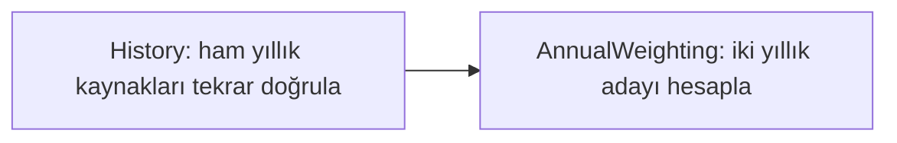

# Yıllık hesabın bağımlılık akışı

Yıllık adayların CLI ve web hesabı artık mevcut bağımlılık motorunda da ayrı iki işlemle çalıştırılabilir. **Hesap yöntemi değişmedi:** [eşit ay ve takvim günü](T2M_ANNUAL_WEIGHTING.md) iki aday olarak kalır. Bu dilim yalnız kayıtlı maskesiz T2M geçmişi içindir; kara/buz, ikinci bilimsel gösterge, eğilim veya yöntem seçimi değildir. [Gerçek kontrol](../evidence/ANNUAL_WORKFLOW_CHECK.md).



## Adımlar ve ortak dil

| Adım / işlem sürümü | Girdi ve çıktı |
|---|---|
| History / ReplayRecordedHistory 0.1.0 | Sabit dosyalardan tekrar hesaplanan geçmiş + yeterli yıllık girdiler; verified_annual_weighting_inputs 0.1.0, degC |
| AnnualWeighting / CompareAnnualWeighting 0.1.0 | History artifact'ini tüketir; mevcut candidate_annual_weighting_audit 0.1.0, degC |

İlk adım kayıtlı request/history/result dosyaları ve her yılın planlanmış ham kaynaklarını bir kez yakalar. Context; bölge/sınır/sürüm, dönem ve bütün dosyaların byte SHA-256 kimliklerini içerir. Geri çağrılar dosyaları yeniden açmaz; NASA isteği, token veya `.env` erişimi yoktur. Tam ham yanıtlar artifact içine taşınmaz. İlk adım kaynakları doğruladıktan sonra yıllık hesap için yalnız ay serisi, hücre alanları ve aynı kaynak yıllık hücre değerleri ayrılır.

History, önceki history.assemble tekrar hesabını kullanır; parent manifest, yıllık dosya hash'leri ve parent sonuç aynı kaynakla eşleşmelidir. AnnualWeighting yalnız doğrulanmış History çıktısını alır. Eski CLI ve yeni akış aynı yıllık hesap fonksiyonunu kullanır; ikinci bir formül uygulanmaz. Kaynak kimliği ve aday bayrakları korunur, sonuç raporuna workflow UUID'si eklenmez. Gerçek artifact/girdi/ata kimlikleri ayrı workflow.json içinde kalır.

Ham veri veya kaynak özeti hatalıysa History failed, AnnualWeighting blocked olur. Çıktı sözleşmesi/birim değişimi örtük dönüştürülmez; yöntem seçen gizli parametre yoktur. Başarılı çalışma içinde eksik ay varsa işlem teknik olarak tamamlanabilir ama o yılın iki adayı null kalır; API yıllık referansı aylığı doldurmaz. Yakalama tamamlandıktan sonraki dosya değişimi çalışan snapshot'ı değiştirmez; yeni build'in context kimliği değişir ve açık compare_snapshot çağrısı önceki iki adımı stale bulur. Kalıcı cache veya otomatik izleme değildir.

## Çalıştırma

Windows CMD, depo kökünden:

```cmd
cd analysis
.venv\Scripts\python.exe -X utf8 -m expedition73 run-annual-workflow --run examples/a-history-2001-2024 --output-dir artifacts/a-annual-workflow-new
```

Mac Terminal, depo kökünden:

```sh
cd analysis
.venv/bin/python -X utf8 -m expedition73 run-annual-workflow --run examples/b-history-2001-2024 --output-dir artifacts/b-annual-workflow-new
```

Her denemede yeni çıktı klasörü seçilir; var olan klasör/symlink üzerine yazılmaz. Modül komutu analysis çalışma dizininden çağrılır.

Başarılı çıktıda dört dosya vardır: request.workflow.json, workflow.json, annual-weighting.json ve trace.json. Trace, workflow_trace.project ile gerçek tamamlanmış artifact bağlantılarından üretilen küçük iki düğümlü projeksiyondur; çalışma UUID'si/özel context/payload kopyalanmaz. Bu dosya webde kendiliğinden gösterilmez. Mevcut webdeki beş düğümlü aylık yüzey grafiği değişmedi.

Çıkış kodu 0 tamamlanmış teknik çalışma, 2 çalışmış ama failed/blocked akış, 1 giriş/yakalama/çıktı hatasıdır. Okunabilir dosyalarda bozuk ham içerik gibi motor hataları 2 ile iki tanı dosyası bırakır; annual-weighting.json veya başarılı trace üretilmez. Yakalamadan önce eksik dosya/bozuk yapılandırma gibi hatalarda motor çalışması oluşmayabilir. [Ortak check](DEV_PACKAGE.md), A/B 24 yıllık yeni akışları geçici ve temizlenen hedeflerde de çalıştırır.

## Sınır

Yeni adapter kaynak kimliğini ve yürütme sırasını gösterir; NASA kaynağının bağımsız doğrulaması veya iklimsel çıkarım değildir. Genel motor 0.1.0, mevcut kaynak/annual/web/ZIP sözleşmeleri aynı kalır. M2'nin bilimsel politika veya ekran kabulü varsayılmaz. Main/Pages yayını ve yeni modülün web akış grafiğine eklenmesi ayrı adımlardır.
